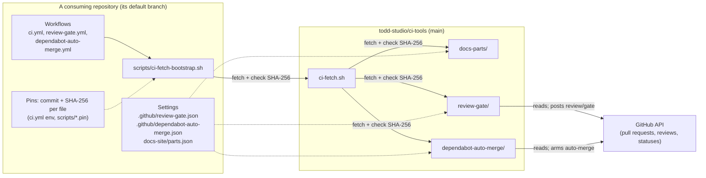

ci-tools is four independent tools that other repositories' CI downloads at a pinned commit and
checks before running. It runs nothing of its own except its CI and its own review gate. This page
says what each tool is responsible for, where its edges are, and how a run flows through it. The
exact commands, settings and workflow text a consumer copies are in the [README](README.md); the
start page is [docs/start-here.md](docs/start-here.md).

## The system as a whole

Everything moves in one direction: a consumer reads files from ci-tools, at a commit it chose,
over `https://raw.githubusercontent.com/todd-studio/ci-tools/<commit>/<path>`. ci-tools never
reaches into a consumer. The consumer owns its pins, its settings and the workflows that call the
tools; ci-tools owns the tools' code and their tests.

## The parts

### `ci-fetch.sh`: the trust root

Downloads one URL and moves it to the destination only if its SHA-256 equals the expected hash
(`ci-fetch.sh <url> <sha256> <dest>`). A hash that is not 64 lowercase hex characters, or the
wrong number of arguments, exits 2; a failed download or a mismatch exits 1 and leaves nothing at
the destination. It runs on GNU and BSD tools alike (`sha256sum`, else `shasum -a 256`).

Its boundary: it checks bytes against a hash it is given and nothing else. Where the hash comes
from is the caller's job, and the rule is that it comes from the upstream project's published
checksums or a checkout of the exact commit, never from what a download produced. It cannot check
itself, so each consumer carries a small `scripts/ci-fetch-bootstrap.sh` that fetches
`ci-fetch.sh` at a full 40-character commit and checks its hash first. That bootstrap lives in the
consumers, not here.

### `docs-parts/`: the docs check

`docs-parts.mjs` runs against a repository's own `docs-site/parts.json`, the list of named parts
and the files each one owns:

| Command      | What it checks                                                                                                                   |
| ------------ | -------------------------------------------------------------------------------------------------------------------------------- |
| `coverage`   | Every tracked file is in exactly one part. Warnings only, unless `--strict`.                                                     |
| `answer`     | A part whose code a pull request changes either has its pages changed or a `Docs: <part> still true — <why>` line in the body. |
| `links`      | Every `code-link` reference on a page still matches the fingerprint recorded when someone last read it.                          |
| `refresh`    | Re-records those fingerprints on the named pages, after a person has re-read them.                                               |
| `boundaries` | The import and reference rules in `docs-site/boundaries.json` hold, and known crossings equal the recorded baseline.             |

Exit 0 is fine, 1 is a finding, 2 is "cannot decide" (an unreadable registry, a git failure, bad
usage, a missing parser), never a silent pass. `code-links.mjs` is the parser behind `links`,
`refresh` and `boundaries`; it also exports `readCodeLink` for a consumer's docs site. The four
files `docs-parts.mjs`, `code-links.mjs`, `package.json` and `package-lock.json` are one unit: a
consumer fetches all four at one commit and runs `npm ci --ignore-scripts` beside them, which
installs `acorn` and `typescript`.

Its boundary: it reads the consumer's checkout and git history and writes nothing, except that
`refresh` rewrites the fingerprints on the pages it is given. A repository with no
`docs-site/parts.json` is not opted in, so `coverage`, `answer` and `boundaries` say so and pass
(`links` still checks any `code-link` fences it finds); a repository
that has opted in passes `--require-registry` so a wrong `--root` cannot read as "nothing to
check". ci-tools itself has no `docs-site/parts.json`.

### `review-gate/`: the review gate and the verdict

`review-gate.mjs` posts the `review/gate` commit status on a pull request's head.
`review-verdict.mjs` is the one rule for what counts as a reviewer's verdict; the gate imports it,
and todd-studio/workstation's `ws review wait`, review backstop and router run a byte-identical
copy whose hash workstation's tests check against its pin.

The rule, in short:

- The pull request body must declare exactly one `Lane: ordinary` or `Lane: guarded` line. Anything
  else is undeclared and treated as guarded.
- **Ordinary** is green with no reviewer, unless the change touches the repository's guarded
  surface; then it is judged as guarded.
- **Guarded** is green only on `toddreviewer01`'s standing native approval of the exact current
  head, or of an earlier head when the current one provably only merges the base branch into it
  (the gate compares git trees to prove this).
- With `dependabot` set, Dependabot's own change, checked against GitHub's identity, commit
  authorship and signature records, is green without a reviewer.
- With `ciOnly` set, any readable lane declaration is green.

Required CI is not the gate's business: branch protection requires those checks separately.

Its boundary: the gate decides only from GitHub's API and the consumer's default-branch checkout,
never from the pull request's own files or from review prose. Its per-repository differences are
settings in `.github/review-gate.json` (`guardedFiles`, `guardedEntryPoints`, `dependabot`,
`ciOnly`), never a fork of the code. The settings file is always on the guarded surface itself.

### `dependabot-auto-merge/`: arming Dependabot's safe updates

`dependabot-auto-merge.mjs` runs in a consumer's `pull_request_target` workflow. With `--clear` it
withdraws any earlier auto-merge request. Without it, it reads fresh pull-request facts and
`dependabot/fetch-metadata`'s output, and asks GitHub to squash-merge that exact head once checks
pass, only when every one of these holds: an open, non-draft pull request by Dependabot's bot
account, with exactly one commit, a same-repository head, the default branch as base, and every
dependency a minor or patch update in an ecosystem listed in `.github/dependabot-auto-merge.json`.

Its boundary: it only requests auto-merge. Required CI and `review/gate` still decide whether the
merge happens. It arms as the consumer's merge App, so the merge's own `push` CI runs; it never
falls back to the workflow's default token.

### This repository's own CI and gate

`.github/workflows/ci.yml` runs three jobs on every pull request and push to `main`:

- **Trust root**, on ubuntu-24.04 and macos-15: ShellCheck (Linux only) and
  `tests/ci-fetch.test.sh`.
- **docs-parts check**: `tests/docs-parts.test.mjs` and `tests/code-links.test.mjs`.
- **review gate**: the gate, verdict and Dependabot arming tests.

`.github/workflows/review-gate.yml` and `.github/workflows/dependabot-auto-merge.yml` run this
repository's own copies of the gate and the arming script from its default-branch checkout, not
from a pin, so a pull request never supplies the code that judges it. The cost is that a change to
either takes effect here only after it merges. `.github/workflows/review-verdict-wake.yml` is a
no-permission, no-checkout workflow that turns a reviewer's submitted or dismissed review into a
`workflow_run` the gate can act on, because GitHub runs review events from the pull request's
merge revision.

## The important flows

### A consumer runs a tool

1. Its workflow runs `scripts/ci-fetch-bootstrap.sh <commit> <sha256> "$RUNNER_TEMP/ci-fetch.sh"`.
   The bootstrap fetches `ci-fetch.sh` at that commit and refuses it unless the hash matches.
2. `ci-fetch.sh` fetches each tool file at the commit in the matching pin file, checking each hash.
3. The workflow runs the tool against its own default-branch checkout and settings.

Any failed fetch or mismatch stops the job. For the review gate that means no status is posted,
and an absent required status blocks the merge.

### A pull request meets the review gate

1. Opening, pushing to, editing, or moving a pull request between draft and ready starts the
   consumer's `review-gate.yml` (`pull_request_target`). So does a review by `toddreviewer01`,
   through `review-verdict-wake.yml` and then `workflow_run`.
2. The gate posts `pending` ("evaluating") on the head, then reads the pull request, its settings
   and, as needed, its changed files, commits and reviews.
3. It posts `success` or `failure` with a one-line reason. If anything it needs is unreadable, or
   the head moved while it was reading, it posts nothing more and the pending status stands.

### A Dependabot update merges on its own

1. Dependabot opens or updates a pull request; the consumer's `dependabot-auto-merge.yml` runs.
2. `--clear` withdraws any earlier request, so a new head must earn eligibility again.
3. `fetch-metadata` describes the update; the script arms auto-merge on that exact head if it is
   eligible, or prints `Not eligible: left for review`.
4. GitHub merges once required CI and `review/gate` are green.

## Integrations and APIs

- **GitHub REST API**, from `review-gate.mjs`: pull requests, their files, commits and reviews,
  commit-to-pull-request lookups, compares and git trees (read); commit statuses (write).
- **GitHub CLI**, from `dependabot-auto-merge.mjs`: `gh api` to read the pull request, and
  `gh pr merge --auto --squash --match-head-commit` or `--disable-auto` to arm or clear.
- **raw.githubusercontent.com**: how consumers fetch every file here. This is why the repository is
  public, and why nothing secret may ever be in it.
- **GitHub Actions**: `dependabot/fetch-metadata` and `actions/create-github-app-token` in the
  Dependabot workflow; `actions/checkout` and `actions/setup-node` in CI. Each is pinned to a
  commit.
- **npm**: `acorn` and `typescript`, pinned by `docs-parts/package-lock.json`.

## Where data is stored

Nowhere here. ci-tools has no database, cache or state file. Every fact the tools act on lives in
GitHub (pull requests, reviews, commit statuses) or in the consumer's own files (pins, settings,
`docs-site/parts.json`, the fingerprints recorded on its pages). The one thing the docs check
writes is those page fingerprints, and only when someone runs `refresh`.

## Deployment and environments

There is no deploy. Merging to `main` publishes a new commit that any consumer may pin; nothing
changes for a consumer until it moves its pin
([guide](docs/guides/move-a-project-to-a-newer-ci-tools-commit.md)). That is why `main` is never
rewritten and changes stay backward-compatible ([AGENTS.md](AGENTS.md)).

The tools run in two environments: GitHub Actions runners (ubuntu, and macOS for the downloader's
tests) and Todd's Macs, where workstation's `scripts/docs-parts.sh` runs the docs check locally from
a verified cache. `main` is protected by a ruleset that blocks deletion and force-pushes, requires
linear history and a pull request, and requires `Trust root (ubuntu-24.04)`, `Trust root
(macos-15)`, `docs-parts check`, `review gate` and `review/gate`.

To see which repositories use which tool at which commit, read their pin files: the
`CI_TOOLS_COMMIT` and `CI_FETCH_SHA256` env in `ci.yml`, and `scripts/review-gate.pin`,
`scripts/dependabot-auto-merge.pin` and `scripts/docs-parts.pin`. Each moves independently.

## Decisions

ci-tools has no `docs/adr/` yet. The decisions that gave it this shape are recorded in the issues
that made them:

- [workstation#2763](https://github.com/todd-studio/workstation/issues/2763): publish the docs
  check from here so workstation and plates-web run the same bytes.
- [workstation#3040](https://github.com/todd-studio/workstation/issues/3040): one review gate for
  every repository, fetched from here, with per-repository differences as settings.
- [workstation#5159](https://github.com/todd-studio/workstation/issues/5159): share Dependabot
  auto-merge arming with every repository that has CI.
- [ci-tools#26](https://github.com/todd-studio/ci-tools/issues/26): this repository's `main`
  requires `review/gate`, so guarded changes here are reviewed too.
- [ci-tools#34](https://github.com/todd-studio/ci-tools/issues/34): the lane declaration ignores a
  footer a bot appends to the pull request body.
